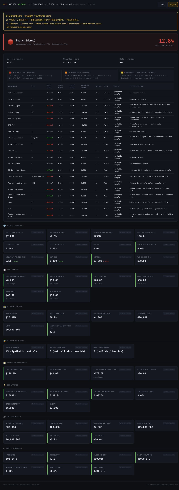

# BTC Dashboard — 20-indicator offline demo

[中文](README.md) · [English](README.en.md)

**[Try the demo — no installation](https://linqingzi.github.io/btc-dashboard-open-source/)** · No download, Python, account, or API key needed. Open the page to explore 20 indicators and three scoring tiers, then click **English** in the top-right corner. Works on desktop and mobile.

The initial page load needs internet access. Its fixed synthetic data was generated offline; the browser only reads this site's synthetic JSON. There is no live market feed, trading, data upload, or automatic market-data refresh. For code changes or local offline use, follow the [advanced local path](#run-locally-in-three-minutes).

**Explore how 20 Bitcoin fundamentals inputs feed a three-tier rule-based score on your own computer.** All inputs are reproducible synthetic fixtures, suitable for reading the scoring code, understanding the schema, and experimenting with the interface.

Python standard library + vanilla HTML/CSS/JavaScript. No API keys or package installation required.

This demonstration provides no live market data, profit signals, or investment advice. Values, dates, and bullish/bearish labels come from fictional examples. “Data coverage” is not prediction accuracy.

**English UI — actual full-page screenshot**



*Captured directly from the running local browser after clicking **English**, without AI-generated imagery. All indicator names, interpretations, tiers, states, and data cards are in English. Only the synthetic-demo notice and language buttons retain both languages. Inputs are the repository's synthetic fixtures, with no real market data, account data, or personal paths.*

[English overview](docs/images/dashboard-demo-en.jpg) · [Chinese screenshot](docs/images/dashboard-demo-zh.jpg) · [中文说明](README.md)

The dashboard presents continuous scores, trend factors, Critical / Major / Minor tiers, and macro, sentiment, derivatives, on-chain, and supply cards. The original scoring rules and weights are preserved.

## Run locally in three minutes

Use the demo link above to try the interface immediately. The local path below is for reading or modifying code, regenerating examples, or running locally offline.

Python 3.9 or newer is required. Fixtures are included, so starting the demo does not contact data providers.

```sh
git clone https://github.com/linqingzi/btc-dashboard-open-source.git
cd btc-dashboard-open-source
python3 scripts/generate_demo.py --check
python3 -m http.server 8080 --bind 127.0.0.1
```

Open <http://127.0.0.1:8080>. The server is a local static preview; press `Ctrl+C` to stop it. The browser reads only the local `data/latest.json`, with no external market-data requests.

Use the **中文 / English** buttons in the top-right corner. Chinese is the default; click **English** to switch the interface titles, all indicators and interpretations, tiers, units, states, and errors. Click **中文** to switch back. Switching reuses the loaded input and does not change any values, scores, weights, or calculations. The synthetic-demo / no-live-data / no-investment-signal warning remains available in both languages for clarity, including in screenshots.

Expected result: the command prints `Synthetic fixtures verified.` The page shows **Synthetic demo**, an invented **$10,000** price, **20 indicator rows**, and three scoring tiers. The fixed fixture has **12.8% bullish weight**, a **-27.2 weighted score**, and **98% data coverage**. These values verify that the demo runs; they are not a view of the current market.

If the page does not load, start the server from the repository root and use the HTTP address rather than double-clicking `index.html`. If port 8080 is in use, change both the server command and browser address to port 8081.

Regenerate the same fixtures:

```sh
python3 scripts/generate_demo.py
python3 scripts/generate_demo.py --check
```

The generator uses fixed constants and creates eight fictional hourly points plus the scored snapshot. It reads no keys or market data. The dates intentionally fall in 2000 to distinguish the example from real Bitcoin history.

## Verify

```sh
python3 -m unittest discover -s tests -v
```

With Node.js 18 or newer installed, also run:

```sh
node --check app.js
node tests/test_frontend.js
```

These checks cover reproducible fixtures, compatible scoring inputs and outputs, missing-data handling, and rendering. Frontend checks include Chinese/English click handlers, all 20 indicators, 60 rule interpretations, five divergence alerts, unchanged inputs/scores, and no additional data request when switching. No packages or market data are downloaded.

## Files

```text
index.html                  Dashboard layout, language buttons, bilingual warning
app.js                      Local fixture rendering and display-only language switch
i18n.js                     Chinese / English display translations
scripts/scoring.py          Original scoring rules and weights
scripts/generate_demo.py    Deterministic synthetic fixture generator
scripts/build_static_demo.py Package only verified synthetic data and the frontend
data/latest.json            Synthetic snapshot and score output
data/history.json           Eight synthetic history points
tests/                      Offline regression and frontend checks
DATA_POLICY.md              Data boundaries and third-party terms
LICENSE                     MIT
```

Provider names in the scoring configuration describe the original indicator design; displayed demo values are attributed to “Synthetic example.” Weight comments are not a new backtest validation or a profitability claim.

Coverage is the original rule's weighted data availability, not forecast accuracy. The original history reader does not treat the ETF dictionary as a numerical trend input, so the fixture keeps an ETF trend of zero and total coverage of 98%. This behavior is preserved and covered by regression checks.

## Release and data boundaries

This is an independent public release with new Git history. The owner authorized publishing the original code and scoring rules under MIT. Private history, real market snapshots, personal paths, credentials, collectors, and deployment configuration were excluded.

There are no market-data collectors, scheduled refreshes, automatic data commits, or trade-execution workflows. The no-install entry uses this public repository's GitHub Pages to host the reviewed, fixed synthetic demo. The localhost address is for local preview.

MIT covers this repository's original code, documentation, and generated synthetic examples. It grants no rights to third-party market data. Any real-data integration must be implemented separately after obtaining required rights and complying with provider terms, including attribution and redistribution restrictions. The default page rejects inputs not marked as synthetic; never relabel real data as synthetic. See [data and third-party policy](DATA_POLICY.md).

## Maintaining the static demo

The hosted demo publishes from the root of `gh-pages`. Its six files contain only the frontend, fixed `data/latest.json`, MIT `LICENSE`, and an empty `.nojekyll`. Python, historical data, and repository documents are excluded. There is no backend, credential, third-party script, or data-upload service.

Maintainers can create and inspect the same static bundle locally:

```sh
python3 scripts/build_static_demo.py --output build/demo
python3 -m http.server 8081 --bind 127.0.0.1 --directory build/demo
```

Packaging first verifies the fixed fixtures byte for byte. Modified market values are rejected even if still marked synthetic. Changes to `main` do not automatically update the hosted snapshot: review the bundle before updating `gh-pages`. GitHub Pages builds and publishes static files without collecting or regenerating market data.

## Feedback and contributions

For run failures or unclear instructions, open an [Issue](https://github.com/linqingzi/btc-dashboard-open-source/issues) with your OS and Python / Node versions, command, expected versus actual result, and a minimal reproduction using synthetic data. Remove personal paths, accounts, and secrets from screenshots or errors.

Small pull requests are welcome. Run the checks above and use synthetic test data only. Do not commit API keys, account records, personal paths, or restricted data.

## License

[MIT License](LICENSE) · Copyright (c) 2026 linqingzi.
