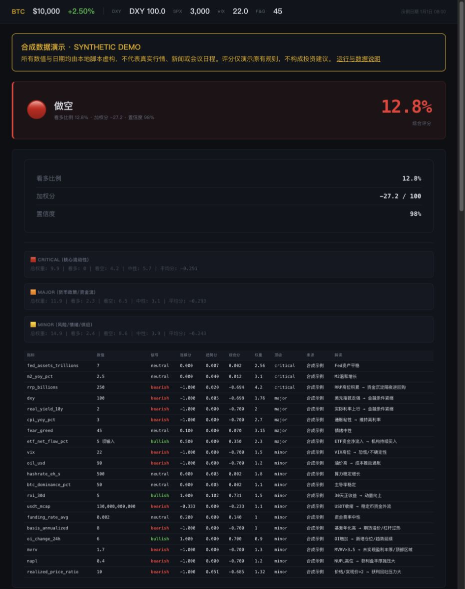

# BTC Dashboard — 20 指标离线演示

**在本机探索 20 个 BTC 基本面指标如何组成 3 层规则评分。** 所有输入均为可重现的合成数据，适合阅读评分代码、理解字段结构和试改界面。

An offline Bitcoin fundamentals demo: 20 indicators, 3 scoring tiers, and reproducible synthetic fixtures. Python standard library + vanilla JavaScript; no API keys or package installation required.

这是演示工具，不提供实时行情、盈利信号或投资建议。数值、日期及页面中的多空结论均来自虚构示例；“置信度”不代表预测准确率。



*由本机浏览器直接截取，未使用 AI 生图；输入均为仓库自带的固定合成示例，无真实行情或账户数据。*

可以看到连续评分、趋势因子、Critical / Major / Minor 三层权重，以及宏观、情绪、衍生品、链上和供应卡片。规则与限制见下文及 [数据政策](DATA_POLICY.md)。

## 3 分钟本机上手

需要 Python 3.9 或更新版本。演示文件已随仓库提供，启动不需要访问数据供应商。

```sh
git clone https://github.com/linqingzi/btc-dashboard-open-source.git
cd btc-dashboard-open-source
python3 scripts/generate_demo.py --check
python3 -m http.server 8080 --bind 127.0.0.1
```

打开 <http://127.0.0.1:8080>。服务器仅用于本机静态预览；按 `Ctrl+C` 停止。浏览器只读取本机的 `data/latest.json`，不会请求外部行情接口。

预期结果：命令行显示 `Synthetic fixtures verified.`；页面顶部显示 **SYNTHETIC DEMO**，示例价格为 **$10,000**，指标明细有 **20 行**，并显示 3 层评分。固定示例的看多比例为 **12.8%**、加权分为 **-27.2**、数据覆盖置信度为 **98%**。这些数值只用于确认运行结果，不代表当前市场判断。

如果页面加载失败，确认服务器从仓库根目录启动，并使用上面的 HTTP 地址；不要直接双击打开 `index.html`。若 8080 端口已被占用，可将命令与浏览器地址中的端口同时改成 8081。

重新生成同一组示例：

```sh
python3 scripts/generate_demo.py
python3 scripts/generate_demo.py --check
```

生成器只使用代码中的固定常数，输出固定的 8 个虚构小时点及评分快照，不读取密钥或真实行情。示例刻意使用 2000 年的日期，以便区分真实市场历史。

## 验证

```sh
python3 -m unittest discover -s tests -v
```

如已安装 Node.js 18 或更新版本，还可运行前端渲染检查：

```sh
node --check app.js
node tests/test_frontend.js
```

这些检查验证合成数据可重现、字段与评分输出兼容、缺少数据时可处理，以及前端能呈现全部指标。测试无需下载软件包或行情数据。

## 内容

```text
index.html                  原有看板布局，增加醒目的合成数据说明
app.js                      读取本地示例、呈现卡片与评分明细
scripts/scoring.py          原有评分规则与权重
scripts/generate_demo.py    确定性的合成数据生成器
data/latest.json            合成快照与评分输出
data/history.json           8 个合成历史点
tests/                      离线回归与前端渲染检查
DATA_POLICY.md              数据边界、第三方名称与集成限制
LICENSE                     MIT
```

评分模块保留了原有规则、权重与计算方式。规则中的数据源名称说明指标的设计背景；演示页面把数值统一标为“合成示例”。权重注释不是本次发布的回测验证或收益承诺。

评分中的“置信度”是原规则的数据覆盖权重，不是预测准确率。原有历史读取器不会把 ETF 字典作为数值趋势输入，因此此示例的 ETF 趋势为零、总置信度为 98%；该行为保留并有回归检查。

## 发布与数据边界

这是一个使用全新 Git 历史的独立公开版本。仓库所有者已授权公开自有代码及评分规则，并采用 MIT。旧私有仓库、真实行情快照、旧提交、个人本机路径、密钥、采集器和部署配置均未纳入此版本。

本版本不包含定时采集、自动提交、自动发布、交易执行或部署工作流。也没有托管的在线演示；上面的地址仅指本机预览。

MIT 适用于本仓库自有代码、文档及生成的合成示例，不会授予任何第三方行情数据的使用或再分发权。实际数据接入须由使用者自行实现，并预先取得供应商要求的权限、遵守其条款；默认页面会拒绝未标记为合成的数据。详见 [数据政策](DATA_POLICY.md)。不要将真实行情改标为合成数据。

## 反馈与贡献

遇到运行问题或说明不清楚的地方，请到 [Issues](https://github.com/linqingzi/btc-dashboard-open-source/issues) 描述：操作系统及 Python / Node 版本、执行的命令、预期与实际结果，以及能用合成数据复现的最小步骤。附截图或错误信息前，请移除个人路径、账户与密钥。

欢迎提交小范围 Pull Request。提交前运行上述检查，只使用合成测试数据；不要提交 API 密钥、账户记录、个人路径或受限数据。

## 授权

[MIT License](LICENSE) · Copyright (c) 2026 linqingzi。
